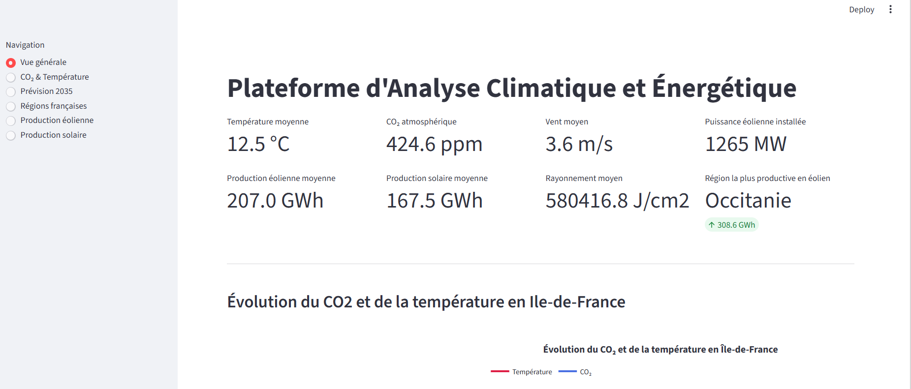
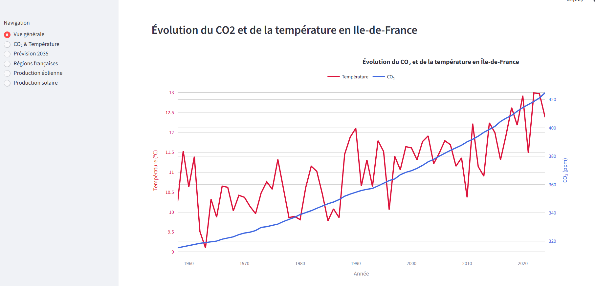
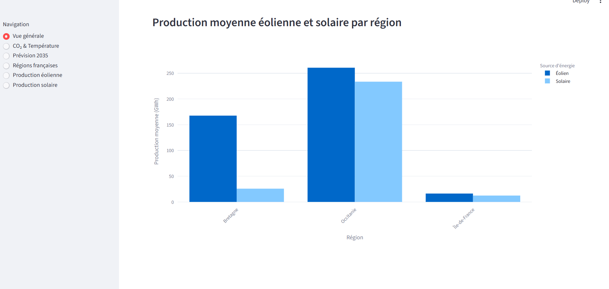
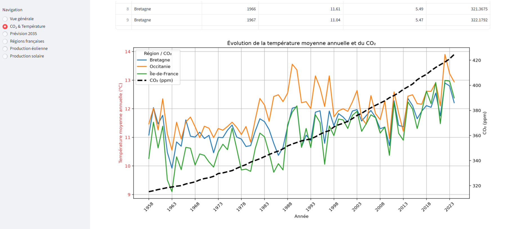
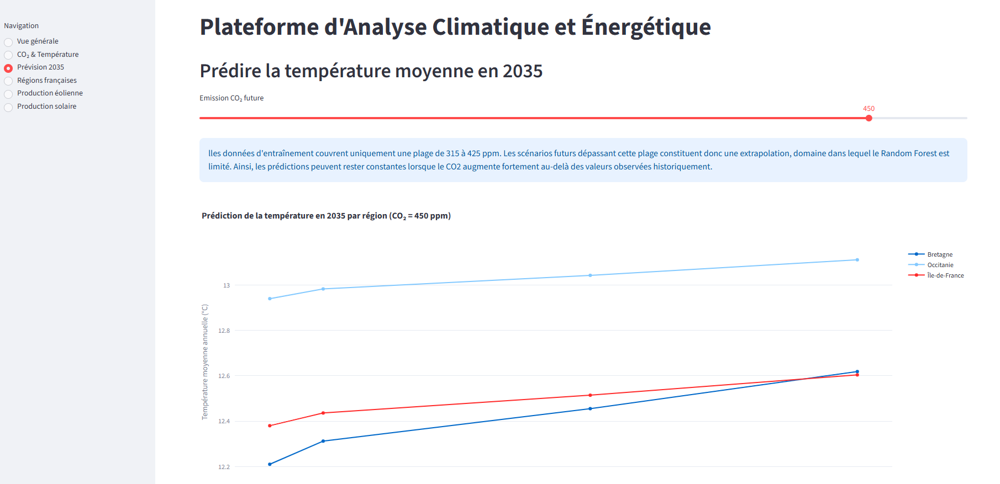
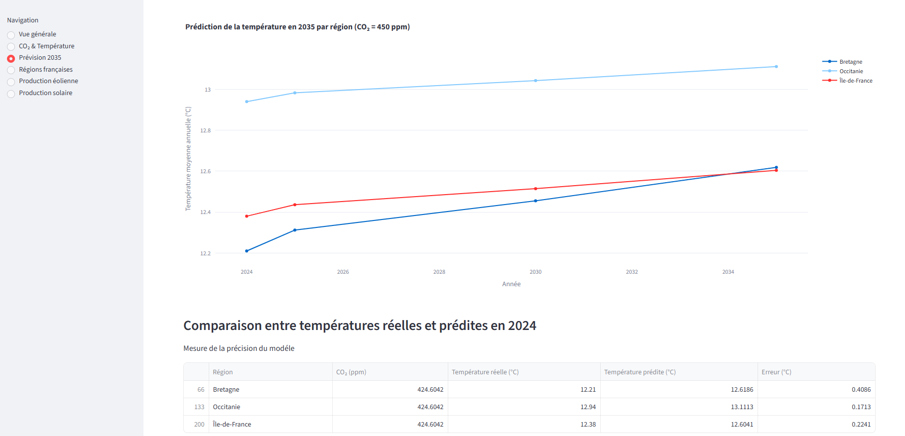
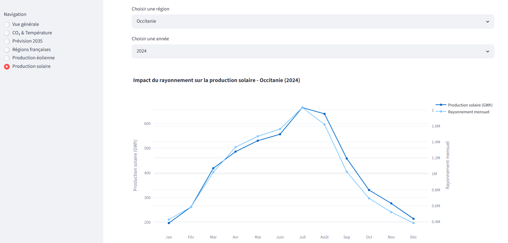
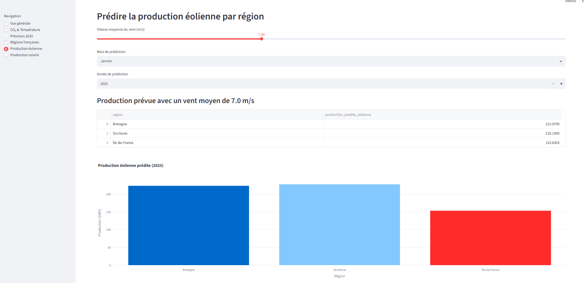
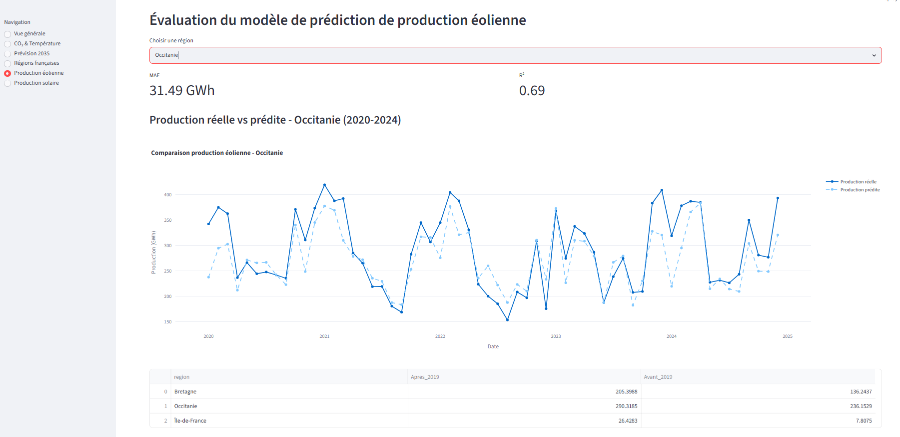

# Météo - Énergie - Climat


## Présentation du projet

**Météo - Énergie - Climat** est un projet d'analyse et de prédiction autour des données météorologiques, énergétiques et climatiques.

L'objectif est de mettre en pratique les compétences acquises durant la formation en travaillant sur des **datasets réels et volumineux**, en explorant différentes techniques de traitement de données, de visualisation et de modélisation prédictive.

L'application permet de :

* Explorer les données météorologiques et énergétiques - météo france
* Analyser la production solaire
* Analyser la production éolienne
* Identifier les principaux facteurs influençant la production
* Entraîner des modèles de Machine Learning
* Prédire la production énergétique
* Comparer différentes régions françaises
* Évaluer les performances des modèles

# Objectifs

Le projet poursuit plusieurs objectifs.

### Analyse des données

Comprendre les relations entre :

* température
* vitesse du vent
* ensoleillement
* précipitations
* rayonnement solaire
* production solaire
* production éolienne

### Visualisation

Créer des visualisations permettant de comprendre rapidement :

* l'évolution de la production énergétique
* les variations saisonnières
* les tendances météorologiques
* les corrélations entre météo et production
* les différences entre régions

### Machine Learning

Construire des modèles capables de prédire :

* la production solaire
* la production éolienne
* la température moyenne en 2035

### Application

Mettre à disposition les résultats à travers une application web interactive permettant à l'utilisateur d'explorer les données et de tester les prédictions.


# Problématique

La problématique principale retenue est :

> **Dans quelle mesure les conditions météorologiques permettent-elles de prédire la production d'énergie renouvelable en France ?**

Plusieurs questions secondaires pourront être étudiées :

* Quelle est l'influence de la vitesse du vent sur la production éolienne ?
* Quel est l'impact de l'ensoleillement sur la production solaire ?
* Existe-t-il une saisonnalité importante de la production ?
* Quelles régions françaises présentent le meilleur potentiel solaire ou éolien ?
* Quels paramètres météorologiques sont les plus importants pour prédire la production ?
* Quel modèle de Machine Learning obtient les meilleures performances ?
* Peut-on anticiper la production énergétique à court terme ?


# Sources des données

Le projet s'appuie notamment sur les jeux de données suivants.

### Production éolienne et solaire

[Parc national annuel de production éolien et solaire — data.gouv.fr](https://www.data.gouv.fr/datasets/parc-national-annuel-de-production-eolien-et-solaire-2001-a-2025)

Ce dataset permet d'étudier l'évolution de la production renouvelable en France sur plusieurs années.

### Production mensuelle

[Courbes de production mensuelles éolien/solaire — data.gouv.fr](https://www.data.gouv.fr/datasets/courbes-de-production-mensuelles-eolien-solaire-complement-de-remuneration)

Ces données permettent notamment d'étudier la saisonnalité de la production.

### Données météorologiques

[Météo-France — données météorologiques](https://meteo.data.gouv.fr/datasets/6569b51ae64326786e4e8e1a)

Les données météorologiques permettent de mettre en relation les conditions météo avec la production énergétique.

### Données climat / CO₂

[Global CO₂ vs Temperature Anomaly Dataset — Kaggle](https://www.kaggle.com/datasets/alitaqishah/global-co-vs-temp-anomaly-dataset-19582025)

Ces données pourront être utilisées pour une extension du projet consacrée à l'étude des relations entre émissions de CO₂ et évolution des températures.


# Stack technique


| Technologie          | Utilisation                    |
| -------------------- | ------------------------------ |
| **Python**           | Langage principal              |
| **Pandas**           | Manipulation des données       |
| **NumPy**            | Calcul numérique               |
| **Scikit-learn**     | Machine Learning               |
| **Matplotlib**       | Visualisation                  |
| **Seaborn**          | Analyse exploratoire           |
| **Streamlit** | Exploration et expérimentation |

## Machine Learning

Plusieurs modèles ont été comparé :

* Régression linéaire
* Random Forest
* Gradient Boosting

Les modèles seront évalués avec différentes métriques :

* MAE
* RMSE
* R²
* MAPE

Le modèle présentant le meilleur compromis entre performance, interprétabilité et temps d'exécution sera retenu.

## Application web

L'application est développée avec :

**Streamlit**

Elle permettra de créer rapidement une interface interactive pour :

* filtrer les données
* afficher des graphiques
* sélectionner une région
* sélectionner une période
* saisir des paramètres météo
* obtenir une prédiction


# Installation

## 1. Cloner le projet

```bash
git clone https://github.com/emfall2015/meteo_energie_climat.git

cd meteo_energie_climat
```

## 2. Créer un environnement virtuel

### Linux / macOS

```bash
python3 -m venv .venv

source .venv/bin/activate
```

### Windows

```bash
python -m venv .venv

.venv\Scripts\activate
```

## 3. Installer les dépendances

```bash
pip install -r requirements.txt
```


# Installation des données

Télécharger les datasets depuis les sources officielles puis les placer dans :

```text
data/
```

Les données brutes ne sont pas versionnées dans Git afin d'éviter de surcharger le repository.


# Préparation des données

Les données passent par plusieurs étapes :

```text
Données brutes
      ↓
Nettoyage
      ↓
Gestion des valeurs manquantes
      ↓
Normalisation des formats
      ↓
Fusion des datasets
      ↓
Feature Engineering
      ↓
Dataset final
      ↓
Machine Learning
```

Les principales opérations sont :

* suppression des doublons
* traitement des valeurs manquantes
* conversion des dates
* harmonisation des unités
* détection des valeurs aberrantes
* agrégation temporelle
* fusion des données météo et énergétiques


# Feature Engineering

Afin d'améliorer les performances des modèles, plusieurs variables pourront être créées.

### Variables temporelles

```text
année
mois
jour
jour_de_la_semaine
saison
```

### Variables météorologiques

```text
température
vitesse_du_vent
direction_du_vent
ensoleillement
rayonnement_solaire
précipitations
pression
```

### Variables dérivées

Par exemple :

```text
moyenne_mobile_7j
moyenne_mobile_30j
production_lag_1
production_lag_7
production_lag_30
```

# Modélisation

Le projet suivra une démarche classique de Machine Learning.

```text
Dataset
   ↓
Train / Test Split
   ↓
Feature Engineering
   ↓
Entraînement
   ↓
Validation
   ↓
Comparaison des modèles
   ↓
Sélection du meilleur modèle
   ↓
Prédiction
```

#  Lancement de l'application

Depuis la racine du projet :

```bash
streamlit run app.py
```

L'application sera ensuite accessible localement à l'adresse indiquée par Streamlit.

# Aperçu de l'application

Voici quelques captures d'écran de l'application.

## Page d'accueil







## Evolution de la température et du co2



## Prédiction de la temperature en 2035 par région





## Impact Rayonnement sur la production solaire



## Prédiction production éolienne par région



## Evaluation prédiction production éolienne




# Évolutions possibles

* Prévision de production en temps réel
* Intégration de données météo en temps réel
* Prévision de la production à J+1 / J+7
* Déploiement cloud
* Monitoring des modèles
* MLOps 

# Licence

Projet réalisé dans un cadre pédagogique.

Les données utilisées restent soumises aux licences et conditions d'utilisation de leurs sources respectives.

